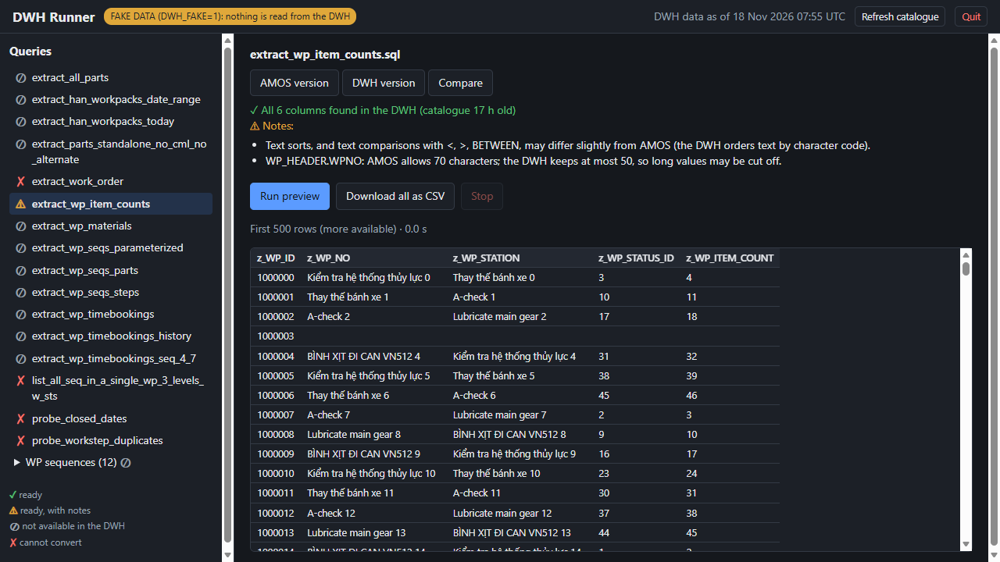
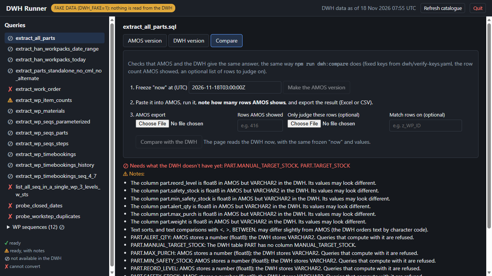
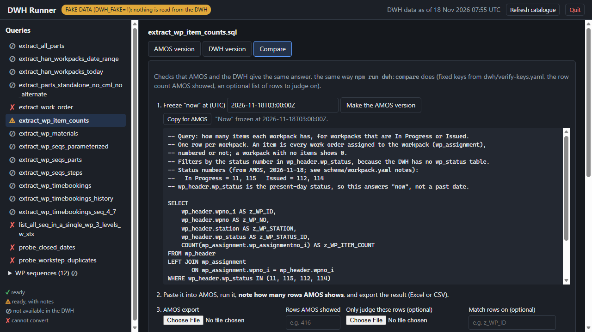

# DWH Runner: guide

The DWH Runner is a web page that runs the repo's AMOS queries against the DWH (the Oracle staging copy of AMOS) and lets you look at the result, download it as a CSV for Excel, and compare it with an AMOS export. It only ever reads: nothing it does can change AMOS or the DWH.

It runs on one PC, the **host PC**, which has the repo, Node.js and the `.env` settings file. Colleagues need only a browser.

- [Part 1: for the host](#part-1-for-the-host)
- [Part 2: for colleagues](#part-2-for-colleagues)
- [Part 3: using the page](#part-3-using-the-page)
- [When something goes wrong](#when-something-goes-wrong)

## Part 1: for the host

### What the host PC needs

- Windows 11, Node.js 24 or newer (ask IT), this repo, and the `.env` file with the DWH settings (`DWH_SERVER`, `DWH_USER`, `DWH_PASSWORD`). Never share or send the `.env` file.
- Access to the company network or VPN, so the PC can reach the DWH.

### Starting it

Double-click **`Start DWH Runner.cmd`** in the repo folder, or the desktop shortcut. It:

1. checks Node.js and the `.env` file and tells you in plain words if one is missing;
2. starts the page in a small minimised window called "DWH Runner - close this window to stop";
3. opens the page in your browser (`http://localhost:4870`).

Double-clicking again while it is running only opens the browser again. To stop it, close the minimised window, or press **Quit** on the page (only the host PC sees Quit).

One-time conveniences (run in a terminal in the repo folder):

| Command | What it does |
|---|---|
| `npm run dwh:shortcut` | Puts a "DWH Runner" shortcut on your desktop. |
| `npm run dwh:autostart` | Starts the DWH Runner when you log in to Windows (without opening the browser). Remove the "DWH Runner" shortcut from the Startup folder (`Win+R`, `shell:startup`) to undo it. |
| `npm run dwh:ui` | Starts the page from the terminal instead of the launcher. |

To try the page **without the DWH** (made-up rows, nothing is read from the DWH, a yellow "FAKE DATA" badge at the top): open a terminal in the repo folder and run `set DWH_FAKE=1` and then `"Start DWH Runner.cmd"`.

### What the page reads from the DWH

Every **Run preview**, **Download** and **Compare** sends one read-only query (the converted version of the repo query) through the DWH link. In addition, **only if you switch it on**, the page asks the DWH at most once every 5 minutes when its data last changed, for the "DWH data as of …" line at the top (otherwise that line says "freshness unknown"). Switch it on by adding the line `DWH_FRESHNESS=1` to the `.env` file yourself, or by running `set DWH_FRESHNESS=1` in a terminal before starting the launcher there. The statement:

```sql
SELECT WP_HEADER.MUTATION AS MUTATION_DAY, MAX(WP_HEADER.MUTATION_TIME) AS MUTATION_MS
FROM STG_AMOS.WP_HEADER
WHERE WP_HEADER.MUTATION = (SELECT MAX(WP_HEADER.MUTATION) FROM STG_AMOS.WP_HEADER)
GROUP BY WP_HEADER.MUTATION
```

**Refresh catalogue** (host only) re-reads the list of DWH tables and columns (the same read as `npm run dwh:catalogue`), saves it as `dwh/catalogue.json` and updates `queries/dwh/`; commit those files afterwards like after `npm run dwh:convert`.

Every run is written to `logs/runner.log` (time, PC address, query, values, rows, time taken). It never contains the `.env` values.

### Sharing the page with colleagues (optional)

Do this only after IT has approved sharing DWH data this way.

1. **Certificate.** The page is shared over HTTPS only. Best: ask IT for a certificate (a `.pfx` file and its password) for this PC's name. Without one, the setup makes a self-signed certificate and colleagues' browsers show a one-time warning.
2. **Run the setup** in a terminal in the repo folder:
   - with an IT certificate: `npm run dwh:share-setup -- --pfx C:\path\to\it-certificate.pfx`
   - without one: `npm run dwh:share-setup`

   It shows the addresses colleagues can use (this PC's name and IP address; add others with `--host name`), asks you to choose the **access code** twice (at least 6 characters; nothing is shown while you type), and for an IT certificate asks its password. Only a scrambled form (hash) of the code is saved, in `dwh/local/share.json`, which is never committed. Optional: `--allow 10.20.0.0/16` lets only that network connect.
3. **Firewall.** Ask IT to allow the port on this PC, for the company network only:

   ```
   netsh advfirewall firewall add rule name="DWH Runner" dir=in action=allow protocol=TCP localport=4870 profile=domain
   ```

4. **Restart** the DWH Runner (close the window, double-click the launcher). The window shows the address for colleagues, for example `https://HOSTPC:4870`.
5. Give colleagues the address and the access code. Change the code by running the setup again; stop sharing with `npm run dwh:share-setup -- --off`.

Keep the host PC on and awake while colleagues use it (Windows Settings, System, Power: set "Sleep" to Never when plugged in), and use `npm run dwh:autostart` so it starts after a restart.

Rules that protect the DWH when shared: everyone uses the one read-only DWH login (the log records who ran what, by PC address); at most four queries run at once and one per person ("The DWH runner is busy, try again in a minute"); five wrong access codes lock that PC out for 15 minutes; only the host can Quit or Refresh the catalogue; only the host adds or changes queries.

## Part 2: for colleagues

1. Open the address the host gave you, for example `https://HOSTPC:4870`, in Edge or Chrome.
2. If the browser warns about the certificate (only when the host uses a self-signed one), choose **Advanced** and **Continue**. This happens once.
3. Enter the access code. You stay signed in for 12 hours.

If the page does not open: the host PC may be off, asleep, or the DWH Runner not started. Ask the host.

## Part 3: using the page



*(Screenshots were taken with made-up data, hence the "FAKE DATA" badge.)*

**The query list** on the left shows every repo query and whether it can run in the DWH:

| Sign | Meaning |
|---|---|
| ✓ | ready |
| ⚠ | ready, with notes (read them: for example, text may sort a little differently than in AMOS) |
| ⊘ | not available in the DWH: the page names the tables or columns the DWH does not have |
| ✗ | cannot be converted: the page says why (and the line) |



**Selecting a query** shows its notes and the column check ("All 6 columns found in the DWH"). **AMOS version** shows the query as written for AMOS, with **Copy for AMOS**; **DWH version** shows what the DWH receives. The page reads the query file again every time you select it or run it, so an edited query is always the current one.

**Values.** A query with placeholders shows one box per placeholder (for example `<WPNO>`). Spaces pasted from Excel are removed; the page shows the value it used. Through the DWH link, values may contain only letters, digits, spaces and `. _ / -`.

**Run preview** shows the first 500 rows ("First 500 rows (more available)" when there are more). A query with no rows shows its column names and "0 rows".

**Download all as CSV** saves the whole result (up to 2,000,000 rows) as `<query>_DWH_<date-time>.csv`: UTF-8 so Excel reads Vietnamese correctly, dates as `YYYY-MM-DD`, times in UTC. Edge and Chrome ask where to save it and write it while it downloads. **Stop** ends a long download; a file that did not finish always ends with a line starting `INCOMPLETE:` saying why, so it never looks complete.

**Compare** checks that AMOS and the DWH give the same answer, the same way `npm run dwh:compare` does:



1. **Freeze "now".** Leave the time empty for the last whole hour, or type one (UTC). Press **Make the AMOS version**: the query is shown with "today/now" replaced by that moment. **Copy for AMOS**.
2. Paste it into AMOS, run it, **note how many rows AMOS shows**, and export the result (Excel or CSV).
3. Choose the export file, type the row count AMOS showed, and press **Compare with the DWH**. Optional: a list of rows to judge on (a CSV whose first column is the match column, for example workpacks unchanged since the AMOS test copy was taken), and the columns to match rows on.

The page reads the DWH right then, with the same frozen moment and values, and shows **PASS** or **FAIL** with the report (row counts first, then the fixed keys from `dwh/verify-keys.yaml`, the listed rows, and all rows). **Download report** saves it. If the query file changed after step 1, the page says so and asks you to redo steps 1 and 2.

Known and accepted: the DWH keeps rows that were deleted in AMOS, so its counts can be higher than AMOS's.

## When something goes wrong

| You see | What to do |
|---|---|
| "The host PC is not set up to reach the DWH yet (the settings file is missing)." | The `.env` file is missing on the host PC. Whoever set it up must put it back. |
| "Can't reach the DWH server. Is the host PC on the company network or VPN?" | Connect the host PC to the network or VPN, then try again. |
| "The DWH did not accept the username or password saved on the host PC." | The `.env` settings are wrong or the password changed. |
| "The DWH took longer than 2 minutes…" | Try fewer workpacks or a shorter date range, or later. |
| "The DWH runner is busy, try again in a minute." | Others are running queries (four at most), or you already have one running (press Stop). |
| "Too many wrong codes from this PC. Try again in 15 minutes." | Wait 15 minutes, then enter the right code. |
| "Node.js 24 or newer is needed on the host PC." | Ask IT to install Node.js 24. |
| "Sharing is switched on in dwh/local/share.json, but it needs …" | Run `npm run dwh:share-setup` again, or `npm run dwh:share-setup -- --off`. |
| "Something went wrong." with Details | Send the details to whoever maintains the tool. They never contain the password. |
