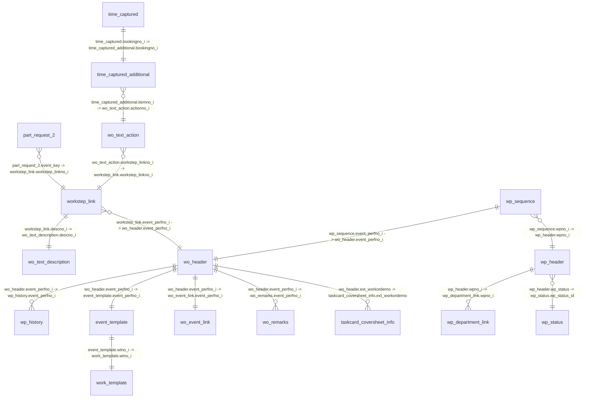

# AMOS Logical Schema

> **Generated file.** Do not edit manually. Update the YAML files in `schema/` instead.

## Entity Relationship Diagram

## part_request

Part requests (materials) for maintenance events (e.g. Worksteps)

| Column | Name | Alias | Type | Trust | Notes/Meaning |
|---|---|---|---|---|---|
| `part_request_2.part_requestno_i` |  |  | INT (int4) | documented | Primary key of the part request. |
| `part_request_2.partno` | part_no | z_PART_NO | PA (varchar(32)) | probed | The requested P/N. |
| `part_request_2.qty` | part_qty | z_PART_QTY | DOUBLE (float8) | probed | The requested quantity of the part. |
| `part_request_2.percentage` |  |  | INT (int4) | probed | The probability that the requested parts are required, ranging from 0% to 100%. |
| `part_request_2.externally_provisioned` |  |  | ALPHANUM (varchar(1)) | probed | Flag to indicate if the provisioning of the part request is handled externally. |
| `part_request_2.no_pcf` | part_no_pcf | z_PART_NO_PCF | BOOL (varchar(1)) | probed | "Y" if the part request must not appear in the Parts Consumption Forecast. |

## timebooking

Time bookings for work steps

| Column | Name | Alias | Type | Trust | Notes/Meaning |
|---|---|---|---|---|---|
| `time_captured.bookingno_i` |  |  | INT (int4) | documented | Primary key for a booking step. |
| `time_captured.user_sign` |  |  | SG (varchar(8)) | documented | The sign of the user who performed the booking step. |
| `time_captured.created_by` |  |  | SG (varchar(8)) | documented | The AMOS user who created this record. |
| `time_captured.start_date` |  |  | DATE_INT (int4) | documented | The date the booking step was started, stored as days since 31.Dec.1971. |
| `time_captured.start_time` |  |  | TIME (int4) | documented | The time the booking step was started, stored as minutes since day begin. |
| `time_captured.end_date` |  |  | DATE_INT (int4) | documented | The date the booking step was stopped, stored as days since 31.Dec.1971. |
| `time_captured.end_time` |  |  | TIME (int4) | documented | The time the booking step was stopped, stored as minutes since day begin. |
| `time_captured.duration` |  |  | TIME_AMO (int4) | documented | The duration in minutes. This is always the difference between end and start time. |
| `time_captured.primkey` |  |  | INT (int4) | documented | The primary key of the task. |
| `time_captured_additional.itemno_i` |  |  | INT (int4) | documented | Foreign key for a specific item within a document. This could be an action on a WO or an item on a task card. The value depends on the MIME type of the corresponding entry in the time_captured table. |

## workorder

Work Order (Taskcard)

| Column | Name | Alias | Type | Trust | Notes/Meaning |
|---|---|---|---|---|---|
| `wo_header.event_perfno_i` |  |  | WO (int4) | documented | Unique identifier for a planning event. This value is negative for templates. |
| `wo_header.ac_registr` |  |  | AC (varchar(6)) | documented | Aircraft registration related to the WO. |
| `wo_header.state` | wp_it_sts | z_WP_IT_STS | ALPHANUM (varchar(2)) | probed | State of a WO: O = Open WO C = Closed WO |
| `wo_header.mech_sign` |  |  | SG (varchar(8)) | documented | Mechanic sign, necessary to close a WO. |
| `wo_header.release_sign` |  |  | SG (varchar(8)) | documented | User sign of the person who released the WO, necessary to close a WO. |
| `wo_header.release_sign2` |  |  | SG (varchar(8)) | documented | Second release sign, necessary if old double inspection is required. |
| `wo_header.closing_date` |  |  | DATE (int4) | documented | Date at WO release, necessary to close a WO, stored as days since 31.Dec.1971. |
| `wo_header.type` |  |  | ALPHANUM (varchar(2)) | documented | WO type: P = PIREP C = Cabin M = Maintenance S = Scheduled T = Template PD = Pending NT = Non-Technical Task |
| `taskcard_coversheet_info.taskcard_number` |  |  | ALPHANUM (varchar(40)) | documented | The Boeing Toolbox Taskcard number used to extract all coversheet information related to this taskcard. DEPRECATED: This information is now stored in an additional table designed for this purpose (bt_taskcard_info). |
| `taskcard_coversheet_info.field_name` |  |  | ALPHANUM (varchar(40)) | documented | The name of the XML attribute (unique per type). |
| `taskcard_coversheet_info.field_value` |  |  | ALPHANUM (text(2147483647)) | documented | The content of the current field. Example: field_name = title field_value = OFFWING ESCAPE SLIDE |
| `taskcard_coversheet_info.sequence` |  |  | INT (int4) | documented | The sequence number of the fields per event, determined by the order in the XML. |
| `taskcard_coversheet_info.type` |  |  | ALPHANUM (varchar(30)) | documented | The type of information stored, such as taskcard, task-procedure, part, or custom data. |
| `wo_remarks.recno` |  |  | INT (int4) | documented | Record number for the Work Order remarks. Primary key together with event_perfno_i. |
| `wo_remarks.recordno` |  |  | INT (int4) | documented | Record number to ensure unique identification of records in case of duplicate recno values |
| `wo_remarks.text` |  |  | ALPHANUM (varchar(70)) | documented | Remark text for the Work Order. |
| `wo_event_link.event_name` | wp_it_name | z_WP_IT_NAME | ALPHANUM (varchar(100)) | probed | Name of the Maintenance Event. It will be used to globally improve the performance of the Maintenance Event framework without using the associated Maintenance Requirements. |
| `wo_event_link.event_display` | wp_it_name_1 | z_WP_IT_NAME_1 | ALPHANUM (varchar(300)) | probed | Display of the Maintenance Event. It will be used to globally improve the performance of the Maintenance Event framework without using the associated Maintenance Requirements. |
| `work_template.template_title` |  |  | ALPHANUM (varchar(250)) | probed | Title of the Jobcard Template, Customer Requirement Template, or Unlinked Work Template.  This column is populated only when the work template is not linked to an event. Data moved from event_template.template_title. |
| `wo_header.shopcard_title` |  |  | ALPHANUM (varchar(250)) | probed | In case of ad-hoc shopcards, where no work_template entry is created, this column is used to save the shopcard title. |
| `wp_history.event_name` | wp_it_name_2 | z_WP_IT_NAME_2 | ALPHANUM (varchar(100)) | probed | Name of the event. |

## workpack

A maintenance workpack (WP) planned at a station, with its status and responsible department(s).

| Column | Name | Alias | Type | Trust | Notes/Meaning |
|---|---|---|---|---|---|
| `wp_header.wpno_i` | wp_id | z_WP_ID | WP (int4) | probed | Internal unique key of the workpack. |
| `wp_header.wpno` | wp_no | z_WP_NO | ALPHANUM (varchar(70)) | probed | Human-readable workpack name (unique). |
| `wp_header.description` | wp_desc | z_WP_DESC | ALPHANUM (varchar(100)) | probed | Description of the Workpackage |
| `wp_header.station` | wp_station | z_WP_STATION | STA (varchar(4)) | probed | Station where the work is planned (e.g. HAN). |
| `wp_department_link.department` | wp_dept | z_WP_DEPT | DEP (varchar(8)) | probed | Department responsible for / handed the WP. One SQL row per department; code groups by wp_id. |
| `wp_header.ac_registr` | ac_reg | z_AC_REG | AC (varchar(6)) | probed | Aircraft-Registry of the affected A/C |
| `wp_header.ac_typ` | wp_ac_type | (proposed) | AT (varchar(6)) | documented | Type of the affected A/C |
| `wp_header.ac_model` | wp_ac_model | (proposed) | AT (varchar(6)) | documented | A/C model |
| `wp_header.wp_type` | wp_type | (proposed) | INT_0 (int4) | documented | Type of the Work Package: 0 = PLANNING Work Package 1 = CRM Work Package Enum: 0=PLANNING Work Package, 1=CRM Work Package |
| `wp_header.hidden` | wp_maint_class | (proposed) | ALPHANUM (varchar(1)) | documented | Defines the visibility of the Workpackage. Possible values are: H: Heavy-Maintenance L: Line-Maintenance I: Hidden Empty or any other value: Unclassified Enum: H=Heavy-Maintenance, L=Line-Maintenance, I=Hidden |
| `wp_header.responsible` | wp_responsible | (proposed) | SG (varchar(8)) | documented | Sign (user code) of the responsible person. |
| `wp_header.wp_status` | wp_status_id | (proposed) | INT (int4) | documented | Current (present-day) status of the WP. Do NOT use to filter historical activity; use start/end dates. |
| `wp_status.name` | wp_status_name | z_WP_STATUS_NAME | ALPHANUM (varchar(50)) | documented | Name of the Workpackage status |
| `wp_status.closed` | wp_status_closed | (proposed) | BOOL (varchar(1)) | documented | Indicates whether the status is considered closed ("Y" for yes, "N" for no) |
| `wp_status.resource_allocation_done` | wp_status_res_alloc_done | (proposed) | BOOL (varchar(1)) | documented | Indicates whether resource allocation is done for this status ("Y" for yes, "N" for no) |
| `wp_header.ops_status` | wp_ops_status | (proposed) | ALPHANUM (varchar(1)) | documented | OPS confirmation of a planned/moved WP. Enum: =Default (no request), Q=Movement queried to OPS, R=Movement rejected by OPS, A=Movement approved by OPS |
| `wp_header.handed_to_prod` | wp_handed_to_prod | (proposed) | BOOL (varchar(1)) | documented | `Y` or `N` depending on the handed to production of the workpackage |
| `wp_header.handed_to_prod_by` | wp_handed_by | (proposed) | SG (varchar(8)) | documented | Sign of the user who handed the WP to production. NULL unless handed_to_prod = Y. |
| `wp_header.handed_to_prod_to` | wp_handed_to | (proposed) | SG (varchar(8)) | documented | Sign of the user the WP was handed to. NULL unless handed_to_prod = Y. |
| `wp_header.handed_to_prod_group` |  |  | ROLE (varchar(12)) | unusable | Role of the group to hand over the workpackage to production Use instead: wp_department_link.department |
| `wp_header.jobcards_collection_status` | wp_jobcards_coll_sts | (proposed) | INT (int4) | documented | Status of the Workpackage collection for jobcards: null: collection not needed 0: collection needed 2: collection completed Enum: 0=Collection needed, 2=Collection completed, null=Collection not needed |
| `wp_header.events_collection_status` | wp_events_coll_sts | (proposed) | INT (int4) | documented | Status of the Workpackage collection for events (taskcards): null: collection not needed 0: collection needed 2: collection completed Enum: 0=Collection needed, 2=Collection completed, null=Collection not needed |
| `wp_header.start_date` | wp_start_date | z_WP_START_DATE | DATE (int4) | documented | Scheduled start date as number of days since 31.Dec.1971 |
| `wp_header.start_time` | wp_start_time | z_WP_START_TIME | TIME (int4) | documented | Scheduled Start-Time in minutes since day begin |
| `wp_header.end_date` | wp_end_date | (proposed) | DATE (int4) | documented | Scheduled end-date as number of days since 31.Dec.1971 |
| `wp_header.end_time` | wp_end_time | (proposed) | TIME (int4) | documented | Scheduled end-time in minutes since day begin |
| `wp_header.act_start_date` | wp_act_start_date | (proposed) | DATE (int4) | documented | Real start date |
| `wp_header.act_start_time` | wp_act_start_time | (proposed) | TIME (int4) | documented | Real Start-Time |
| `wp_header.act_end_date` | wp_act_end_date | z_WP_ACT_END_DATE | DATE (int4) | documented | Real end-date |
| `wp_header.act_end_time` | wp_act_end_time | z_WP_ACT_END_TIME | TIME (int4) | documented | Real end-time |
| `wp_header.arrival_fltno` | wp_arr_fltno | (proposed) | ALPHANUM (varchar(10)) | documented | Last scheduled flight number before the Workpackage can be performed. Relevant only when flight_leg is null. |
| `wp_header.departure_fltno` | wp_dep_fltno | (proposed) | ALPHANUM (varchar(10)) | documented | Flight Number corresponding to the departure flight. This field is required for A/Ps without known A/C registry in order to identify to which Ground Time the W/P belongs to. |
| `wp_header.inbound_scheduled_date` | wp_inbound_date | (proposed) | DATE (int4) | documented | Scheduled date of the inbound flight as number of days since 31.Dec.1971. Used as part of the Maintenance Planning automation framework. |
| `wp_header.inbound_scheduled_time` | wp_inbound_time | (proposed) | TIME (int4) | documented | Scheduled time of the inbound flight in minutes since day begin. Used as part of the Maintenance Planning automation framework. |
| `wp_header.delay` | wp_delay | (proposed) | TIME (int4) | documented | Delay duration in minutes (a duration, not a time of day). |
| `wp_header.non_routine_time` | wp_nonroutine_time | (proposed) | TIME (int4) | documented | Additional non-routine time in minutes (a duration). |
| `wp_header.test_flight` | wp_test_flight | (proposed) | BOOL (varchar(1)) | documented | Indicates if a test flight has been performed as part of this Workpackage ("Y"). Any other value means that no test flight has been performed |
| `wp_header.engrun` | wp_eng_run | (proposed) | BOOL (varchar(1)) | documented | Engine run |
| `wp_header.acweigh` | wp_ac_weigh | (proposed) | BOOL (varchar(1)) | documented | A/C Weigh |
| `wp_header.ndt_req` | wp_ndt_req | (proposed) | BOOL (varchar(1)) | documented | ndt Req |
| `wp_header.def_req` | wp_defuel_req | (proposed) | BOOL (varchar(1)) | documented | defuel req |
| `wp_header.jack_req` | wp_jack_req | (proposed) | BOOL (varchar(1)) | documented | jacking req |
| `wp_header.remarks` | wp_remarks | (proposed) | ALPHANUM (text(2147483647)) | documented | The remarks of a workpackage |
| `wp_header.internal_remarks` | wp_int_remarks | (proposed) | ALPHANUM (text(2147483647)) | documented | The internal remarks of a workpackage |
| *(derived)* | wp_start | (proposed) | computed | - | From: wp_header.start_date, wp_header.start_time |
| *(derived)* | wp_end | (proposed) | computed | - | From: wp_header.end_date, wp_header.end_time |
| *(derived)* | wp_act_start | (proposed) | computed | - | From: wp_header.act_start_date, wp_header.act_start_time |
| *(derived)* | wp_act_end | (proposed) | computed | - | From: wp_header.act_end_date, wp_header.act_end_time |
| *(derived)* | wp_inbound | (proposed) | computed | - | From: wp_header.inbound_scheduled_date, wp_header.inbound_scheduled_time |

## workstep

Work steps and their text actions/descriptions

| Column | Name | Alias | Type | Trust | Notes/Meaning |
|---|---|---|---|---|---|
| `workstep_link.workstep_linkno_i` |  |  | INT (int4) | documented | Unique identifier of the work step link. |
| `workstep_link.descno_i` |  |  | INT (int4) | documented | Foreign key referencing the descno_i of the wo_text_description table (Work Order Text Description). |
| `workstep_link.sequenceno` | workstep_no | z_WORKSTEP_NO | INT (int4) | probed | Step's position in the sequence of steps within the Work Template. |
| `wo_text_description.header` | wp_it_header | z_WP_IT_HEADER | ALPHANUM (varchar(70)) | probed | Header description of the work step. |
| `wo_text_description.text` | wp_it_text | z_WP_IT_TEXT | ALPHANUM (text(2147483647)) | probed | Plain description or work step text. This field is only populated if the text was saved as plain text; otherwise, it is empty (NULL). |
| `wo_text_description.desc_comment` |  |  | ALPHANUM (text(2147483647)) | documented | Comment or remark text related to the work step description. |
| `wo_text_description.text_html` | wp_it_text_html | z_WP_IT_TEXT_HTML | HTML (text(2147483647)) | probed | Formatted description or work step text. This field is only populated if the text was saved as formatted; otherwise, it is empty (NULL). |
| `wo_text_action.actionno_i` |  |  | INT (int4) | documented | Unique primary key - action number |
| `wo_text_action.header` |  |  | ALPHANUM (varchar(70)) | documented | Header/description of the action |
| `wo_text_action.text` |  |  | ALPHANUM (text(2147483647)) | documented | Action text |
| `wo_text_action.action_comment` |  |  | ALPHANUM (text(2147483647)) | documented | Comment text |
| `wo_text_action.sign_performed` |  |  | SG (varchar(8)) | documented | The sign of the user who has performed or written the action |
| `wo_text_action.sign_inspected` |  |  | SG (varchar(8)) | documented | The sign of the user who has inspected the action |
| `wo_text_action.sign_double_inspected` |  |  | SG (varchar(8)) | documented | The sign of the user who has double inspected the action |

## wp_item

Workpack sequence item connecting WP to WO

| Column | Name | Alias | Type | Trust | Notes/Meaning |
|---|---|---|---|---|---|
| `wp_sequence.wp_sequence_id` |  |  | INT (int4) | documented | Primary key for the wp_sequence table. |
| `wp_sequence.seqno_prefix_i` | wp_seq_1st | z_WP_SEQ_1ST | INT (int4) | probed | Prefix for the sequence number, corresponding to the event type or check. For example, if the sequence number is "3.342", this column contains "3". |
| `wp_sequence.seqno` | wp_seq_2nd | z_WP_SEQ_2ND | INT (int4) | probed | The sequence number, starting at 1 for each WP. A negative value indicates a duplicate sequence; the original value is stored in the deprecated old_seqno_i column. |
| `wp_sequence.seqno_prefix_i2` |  |  | INT (int4) | documented | Second prefix for the sequence number, used in conjunction with seqno_prefix_i. This column should only be populated if seqno_prefix_i is not empty. |
| `wp_sequence.seqno_prefix` |  |  | ALPHANUM (varchar(3)) | documented | Deprecated: Prefix for the sequence number, corresponding to the event type or check. For example, if the sequence number is "3.342", this column contains "3". |
| `wp_sequence.seqno2` |  |  | INT (int4) | documented | Secondary sequence number, used by EGME to sequence events grouped by area. |

